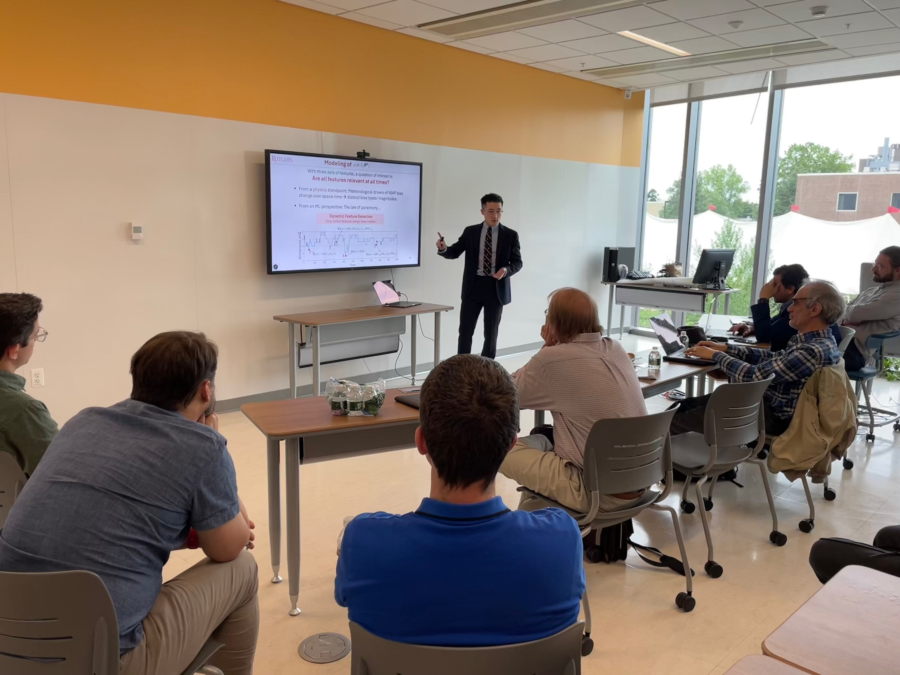
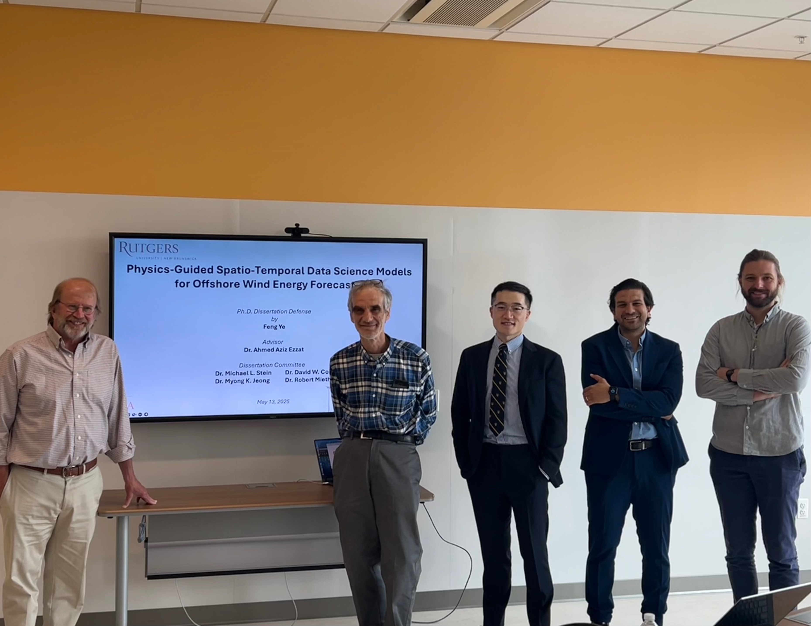
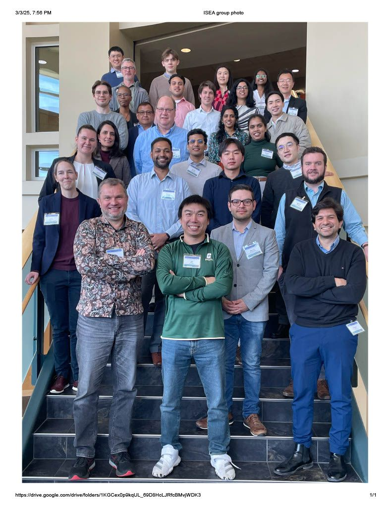
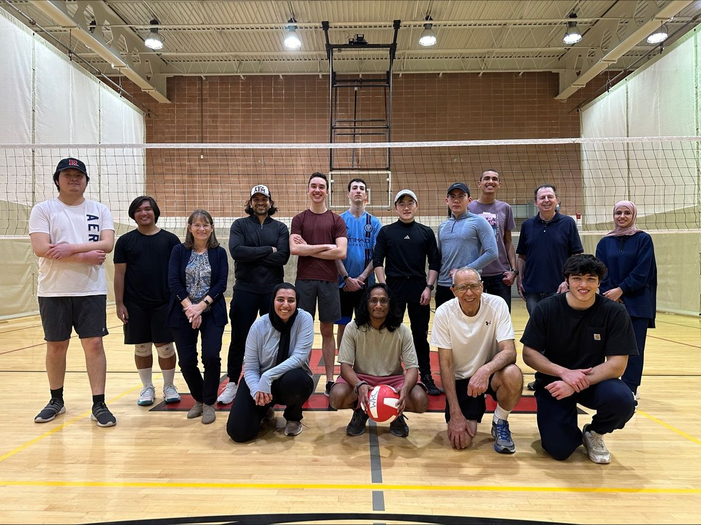
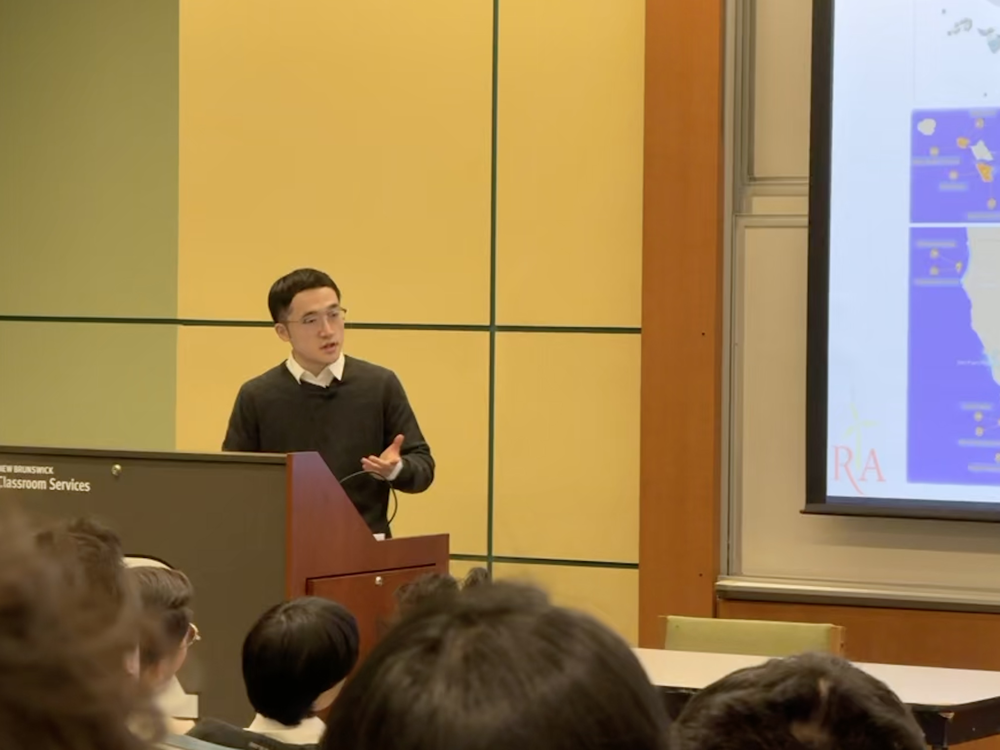
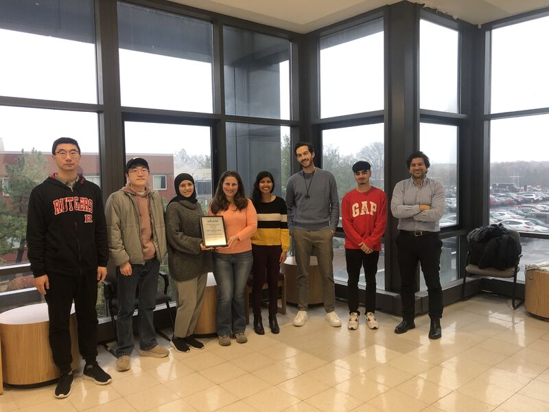
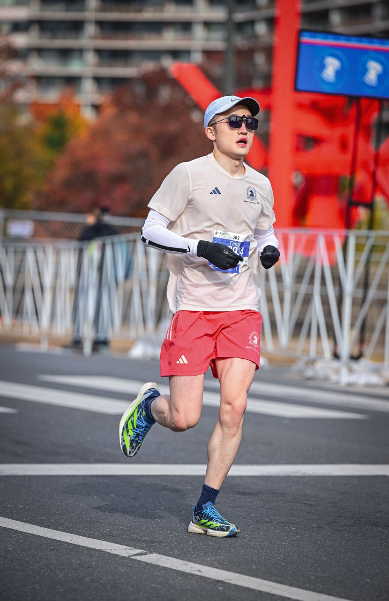
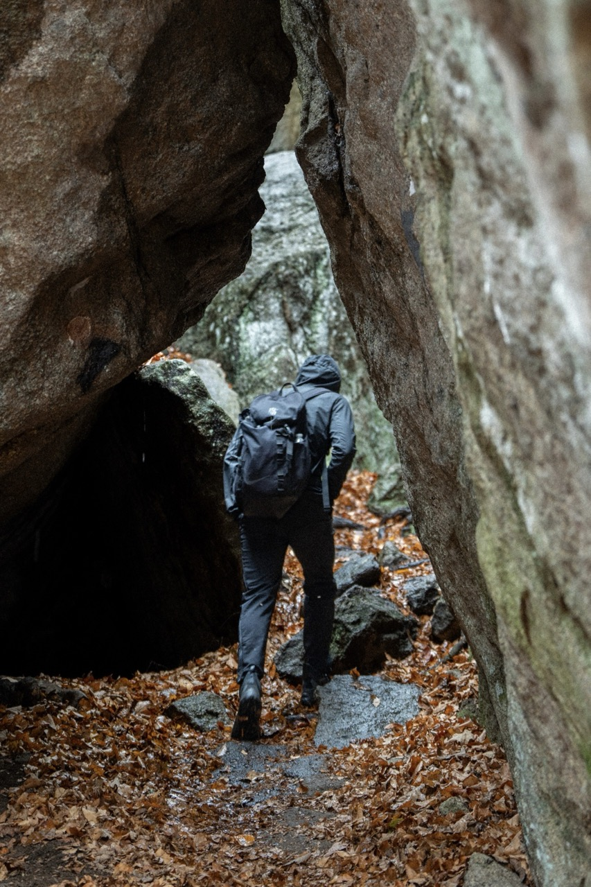
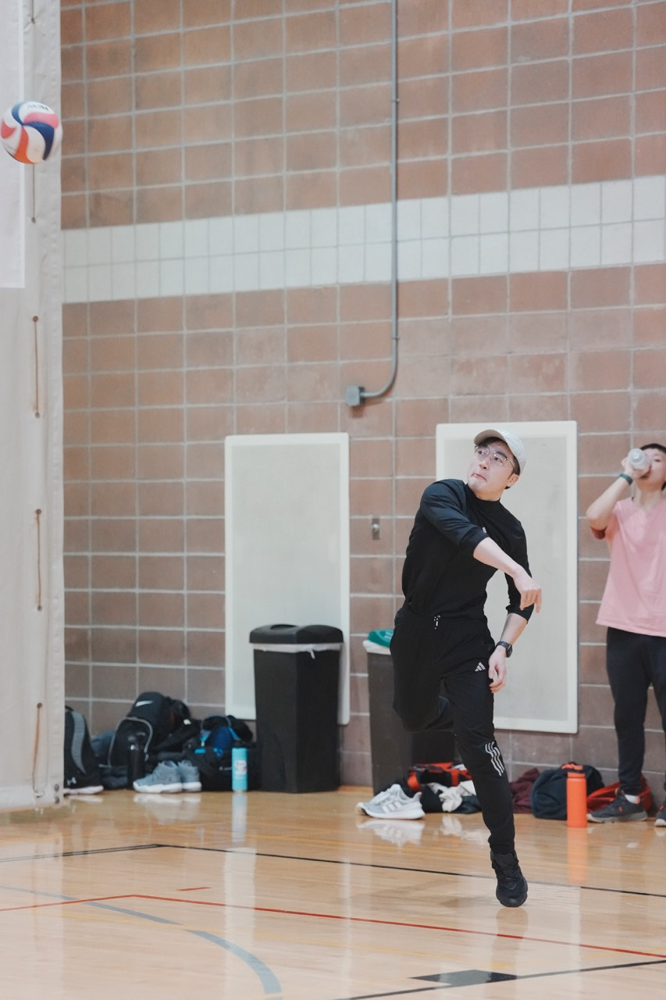
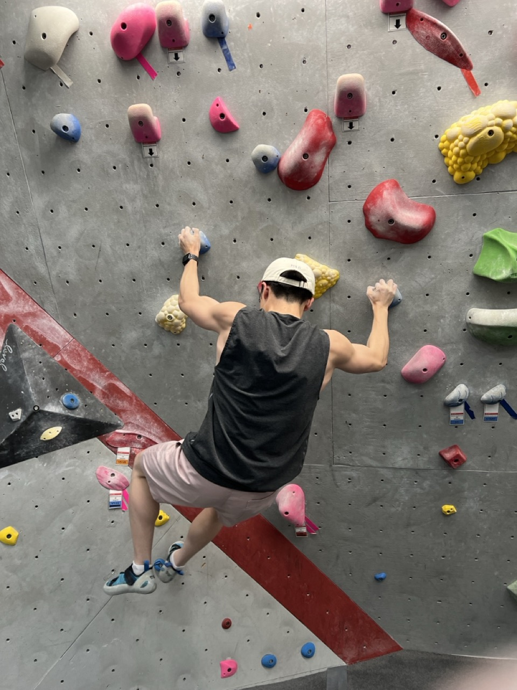








# 👨🏻‍🎓 About Me

I am a tenure-track Assistant Professor in the Department of Industrial Engineering at Clemson University . Before joining Clemson, I received my Ph.D. in Industrial and Systems Engineering in 2025 and my M.Sc. in Statistics in 2023 from Rutgers University–New Brunswick .

<!--My research aims to advance the integration of modern AI/ML, statistics, and physics by constructing physics-guided data science models for industrial applications such as energy and manufacturing.-->

My research focuses on AI/ML and statistical modeling for scientific and engineering systems. I develop methods that learn from data while incorporating domain knowledge and governing principles, with applications in weather, energy, and industrial applications.

<strong>Research interest:</strong>

    

        <ul style="list-style-type: disc; padding-left: 20px; margin: 0;">
            <li>Scientific Machine Learning</li>
            <li>Spatio-temporal Modeling</li>
            <li>Probabilistic Forecasting</li>
        </ul>
    

    

        <ul style="list-style-type: disc; padding-left: 20px; margin: 0;">
          	<li>Physics-guided Generative AI</li>
            <li>Statistical Deep Learning</li>
            <li>Forecast-informed Decision Making</li>
        </ul>
    



# 🔥 News
- *2025.09*: Dr. Ye gave an invited seminar at Clemson University School of Mathematical and Statistical Sciences!

- *2025.08*: Dr. Ye joined Department of Industrial Engineering at Clemson University  as a Tenure-track Assistant Professor!

- *2025.06*: Dr. Ye attended IISE Annual Conference & Expo 2025 in Atlanta!

- *2025.05*: 🎓🎓 I have successfully defended my Ph.D. dissertation, titled *“Physics-Guided Spatio-Temporal Data Science Models for Offshore Wind Energy Forecasting.”* Officially, Dr. Ye!

    

    

      
      
 
    

    

    

        
        

    

    

- *2025.03*: I attended the 2nd International Symposium on Energy Analytics (ISEA2025) and gave a presentation about our work *DeepMIDE*. Many thanks to Dr. Tao Hong for organizing the symposium!

    

    

      
      
 
    

    

    

        
        

    

    

- *2025.01*: I will join [Clemson IE](https://www.clemson.edu/cecas/departments/ie/index.html)  as a Tenure-track Assistant Professor!



# 🏆 Honors and Awards

- [Ralph E. Powe Junior Faculty Enhancement Award](https://www.orau.org/partnerships/grant-programs/powe/index.html), *2026*
- 🥇**First Place**, [IISE QCRE Track Best Student Poster Award](https://soe.rutgers.edu/news/ise-phd-student-wins-best-student-poster-competition-iise-annual-conference), *2024* 
- 🥇**First Place**, [IISE Energy Systems Track Best Paper Award](https://www.linkedin.com/posts/feng-ye-51b3ba252_iiseannual2023-offshorewind-offshorewindenergy-activity-7067279451163611137-S8Bz?utm_source=share&utm_medium=member_desktop&rcm=ACoAAD5aBWcBmRGppw0q2rC85jjxX3ZSKCev4Jc), *2023* 
- 🥇**First Place**, [INFORMS Sustainability Cluster Best Student Paper Award](https://academicaffairs.rutgers.edu/njwind/fengye-wins-INFORMS-award), *2022* 
- New Jersey Wind Institute Fellowship, *2023*
- Rutgers Climate and Energy Institute (RCEI) Student Support Funding Award, *2024*
- Outstanding Ph.D. Student Award (Research), Department of Industrial & Systems Engineering , Rutgers University, *2024*
- Research & Travel Award, School of Graduate Studies, Rutgers University, *2024*
- Graduate Student Service Award, Department of Industrial & Systems Engineering, Rutgers University,  *2024*
- Rutgers University Fellowship, Department of Industrial & Systems Engineering, Rutgers University, *2024*

# 📝 Publications
## Journal Papers

1. S.-T. Yang, **F. Ye**, X. Lu, D. Lin, and B. C. Martinez, “[Physics-Guided Flow Matching: A Generative AI Framework for Global Total Electron Content Forecasting](https://arxiv.org/abs/2610.37159)”, *arXiv preprint*, arXiv:2610.37159, 2026.
2. **F. Ye**, X. Zhang, M. L. Stein, and A. A. Ezzat, “[DeepMIDE: A Multi-Output Spatio-Temporal Method for Ultra-Scale Offshore Wind Energy Forecasting](https://doi.org/10.1080/00401706.2025.2593879)”, *Technometrics*, vol. 68, no. 3, pp. 452–468, 2026.
   - *First Place, 2024 IISE Annual Meeting QCRE Track Best Student Poster Award*
3. M. C. Sahin, **F. Ye**, A. A. Ezzat, O. A. Kilic, and M. Yildirim, “[Accessibility-Aware Stochastic Optimization of Maintenance Scheduling and Vessel Logistics for Offshore Wind Farms](https://doi.org/10.1109/TR.2026.3734892)”, *IEEE Transactions on Reliability*, pp. 1–14, 2026.
4. K. B. Walid, **F. Ye**, J. Ji, A. A. Ezzat, T. Miles, and Y. Jiang, “[Economic and Reliability Value of Improved Offshore Wind Forecasting in Bulk Power Grid Operation: A Case Study of the New York Power Grid](https://doi.org/10.1109/ACCESS.2026.3737067)”, *IEEE Access*, vol. 14, pp. 148337–148357, 2026.
5. J. Ji, **F. Ye**, T. Miles, and A. A. Ezzat, “A Horizon-Dependent Ensemble Method for Probabilistic Forecasting in Offshore Wind Farms”, *INFORMS Journal on Data Science*, accepted.
6. C. Petersen, **F. Ye**, J. Ji, J. Kohut, A. A. Ezzat, D. Saginaw, A. Montanti, and J. Cammarota, “[Accessibility and Serviceability Assessment to Inform Offshore Wind Energy Development and Operations off the US East Coast](https://doi.org/10.1002/we.70131)”, *Wind Energy*, vol. 29, no. 7, e70131, 2026.
7. C. Petersen, J. Ji, **F. Ye**, A. A. Ezzat, J. Kohut, D. Saginaw, A. Montanti, and J. Cammarota, “[Data-Driven Probabilistic Simulation of Vessel Operations to Support the Blue Economy](https://doi.org/10.1016/j.oceaneng.2026.124818)”, *Ocean Engineering*, vol. 354, 124818, 2026.
8. **F. Ye**, T. Miles, and A. A. Ezzat, “[Improved Spatio-Temporal Offshore Wind Forecasting with Coastal Upwelling Information](https://www.sciencedirect.com/science/article/pii/S0306261924023948)”, *Applied Energy*, vol. 380, 125010, 2025.
9. **F. Ye**, J. Brodie, T. Miles, and A. A. Ezzat, “[AIRU-WRF: A Physics-Guided Spatio-Temporal Wind Forecasting Model and Its Application to the U.S. Mid-Atlantic Offshore Wind Energy Areas](https://www.sciencedirect.com/science/article/abs/pii/S0960148123018499)”, *Renewable Energy*, vol. 223, 119934, 2024.
   - *First Place, 2023 IISE Annual Meeting Energy Systems Track Best Paper Award*
   - *First Place, 2022 INFORMS Annual Meeting Sustainability Cluster Best Student Paper Award*
10. **F. Ye** and A. A. Ezzat, “[Icing Detection and Prediction for Wind Turbines Using Multivariate Sensor Data and Machine Learning](https://www.sciencedirect.com/science/article/pii/S0960148124009479)”, *Renewable Energy*, vol. 231, 120879, 2024.
11. Z. Xia, **F. Ye**, M. Dai, and Z. Zhang, “[Real-Time Fault Detection and Process Control Based on Multi-Channel Sensor Data Fusion](https://doi.org/10.1007/s00170-020-06168-y)”, *The International Journal of Advanced Manufacturing Technology*, vol. 115, no. 3, pp. 795–806, 2021.
12. **F. Ye**, Y. Guo, Z. Xia, Z. Zhang, and Y. Zhou, “[Feature Extraction and Process Monitoring of Multi-Channel Data in a Forging Process via Sensor Fusion](https://www.tandfonline.com/doi/abs/10.1080/0951192X.2020.1858509)”, *International Journal of Computer Integrated Manufacturing*, vol. 34, no. 1, pp. 95–109, 2021.
13. Y. Guo, **F. Ye**, Y. Zhou, and Z. Zhang, “[Fault Diagnosis of Multi-Channel Data in a Forging Process Using the Linear Support Higher-Order Tensor Machine](https://www.tandfonline.com/doi/abs/10.1080/0951192X.2020.1780321)”, *International Journal of Computer Integrated Manufacturing*, vol. 33, no. 8, pp. 810–822, 2020.
14. **F. Ye**, Z. Zhang, Z. Xia, Y. Zhou, and H. Zhang, “[Monitoring and Diagnosis of Multi-Channel Profile Data Based on Uncorrelated Multilinear Discriminant Analysis](https://link.springer.com/article/10.1007/s00170-019-03912-x)”, *The International Journal of Advanced Manufacturing Technology*, vol. 103, no. 9, pp. 4659–4669, 2019.

## Conference Papers

1. **F. Ye** and A. A. Ezzat, “[An Integro-Difference Equation Model for Spatio-Temporal Offshore Wind Forecasting](https://ieeexplore.ieee.org/document/10688765)”, *2024 IEEE Power & Energy Society General Meeting (PESGM) Proceedings*, pp. 1–5, 2024.

2. **F. Ye**, J. Brodie, T. Miles, and A. A. Ezzat, “[Ultra-Short-Term Probabilistic Wind Forecasting: Can Numerical Weather Predictions Help?](https://ieeexplore.ieee.org/document/10252311)”, *2023 IEEE Power & Energy Society General Meeting (PESGM) Proceedings*, pp. 1–5, 2023.

## Book Chapters

1. **F. Ye**, T. Miles, and A. A. Ezzat, “[Offshore Wind Energy Prediction Using Machine Learning with Multi-Resolution Inputs](https://link.springer.com/chapter/10.1007/978-3-031-53092-0_8)”, in *Multimodal and Tensor Data Analytics for Industrial Systems Improvement*, edited by N. Gaw, M. Reisi, and P. Pardalos, Cham: Springer International Publishing, pp. 167–183, 2024. (Invited chapter.)

## Patents

1. A. A. Ezzat, **F. Ye**, J. F. Brodie, and T. Miles, “Techniques to Provide Improved Wind Input for Operating Offshore Wind Turbines” (U.S. Patent No. 12,729,664, 2026).
2. Z. Zhang, **F. Ye**, C. Zhen, and M. Dai, “Remote Data Acquisition and Analysis for Process Diagnosis in the Production Line” (Chinese Patent No. CN109086999B, 2021).



# 💬 Invited / Conference Presentations

- **An Integro-Difference Equation Model for Spatio-Temporal Offshore Wind Forecasting**

  - *IEEE Power & Energy Society General Meeting, Seattle, WA July 2024*
- **A Statistical Deep Learning Approach for Offshore Wind Energy Forecasting**
  - *International Symposium on Energy Analytics, Charlotte, NC March 2025*
  - *Rutgers Climate Symposium, New Brunswick, NJ Nov. 2024*
  - *INFORMS Annual Meeting, Seattle, WA Oct. 2024*
  - *IISE Annual Conference & Expo, Montreal, Canada May 2024*
- **AIRU-WRF: A Physics-guided Spatio-temporal Wind Forecasting Model and Its Application to the U.S. Mid Atlantic Offshore Wind Energy Areas**
  - *NAWEA/WindTech 2024 Conference, New Brunswick, NJ Oct. 2024*

  - *New Jersey Offshore Wind Technology Conference, Newark, NJ Dec. 2023*

  - *Rutgers Climate Symposium, New Brunswick, NJ Nov. 2023*

  - *INFORMS Annual Meeting, Phoenix, AZ Oct. 2023*

  - *Wind Institute Research Symposium, Trenton, NJ Apr. 2023*

  - *INFORMS Annual Meeting, Indianapolis, IN Oct. 2022*

  - *IISE Annual Conference & Expo, Seattle, WA May 2022*

- **Ultra-Short-Term Probabilistic Wind Forecasting: Can Numerical Weather Predictions Help?**
  - *IEEE Power & Energy Society General Meeting, Orlando, FL July 2023*

  - *IISE Annual Conference & Expo, New Orleans, LA May 2023*



# 👨🏻‍🏫 Teaching
{: #teaching-title }

- #### **Instructor**

   - ##### @ Clemson
   
      - IE 4910/6910: Engineering Data Analytics, Spring 2026
      - IE 3610: Industrial Applications of Probability and Statistics II, Fall 2025/2026
   
   - ##### @ Rutgers
   
      - 440 EOF Matlab Computer Programming, Summer 2022/2023
   

  

- #### **Teaching Assistant** 01/2022 - 05/2022

  - 14:540:343: Engineering Economics

  - 14:540:462: Facilities Layout and Materials Handling

# 📚 Professional Service and Membership

- **Session Chair/Organizer**:

  - *“Modern Experimental Design”, ASA/IMS SRC, Clemson, SC, May 2026*
  - *“JQT Invited Session”, ASA/IMS SRC, Clemson, SC, May 2026*
  - *“Predictive Analytics for Wind Power Generation”, IISE, Montreal, Canada, May 2024*
  - *“Unique Directions in Energy Research”, IISE, Montreal, Canada, May 2024*
  - *“Forecasting and Data Science for Renewable Energy”, INFORMS, Indianapolis, IN, Oct. 2022*

- **Contributed Program Committee**: ASA/IMS Spring Research Conference 2026

- **Journal Reviewer for**:

  *Technometrics, IISE Transactions, IEEE Transactions on Automation Science and Engineering, IEEE Transactions on Sustainable Energy, Applied Energy, INFORMS Journal on Data Science, Journal of Quality Technology, International Journal of Forecasting, JGR: Machine Learning and Computation, Energy, Journal of Intelligent Manufacturing, Wind Energy Science,  IEEE Open Access Journal of Power and Energy*

- **Conference Reviewer for**:

  - *IEEE International Conference on Automation Science and Engineering (CASE) (2026)*
  - *IISE DAIS Best Track Paper Competition (2026)*
  - *ASA SPES + Q&P Student Paper Competition (2026)*
  - *INFORMS Data Mining Best Paper Competition (2026)*
  - *INFORMS QSR Best Student Paper Competition (2025, 2026)*
  - *INFORMS QSR Best Paper Competition (2025, 2026)*
  - *INFORMS Workshop on Data Mining and Decision Analytics (2026)*

- **Vice President**: Rutgers INFORMS Student Chapter (Cum Laude Award) 10/2022 - 06/2025

  

    

      
      
Volleyball game 
  between ISE faculty & students

  

  

      
      
Joint seminar with Lehigh 
  INFORMS Student Chapter

  

  

      
      
Cum Laude Award from INFORMS
  

  

  

- **Memberships**:

  - Institute of Industrial and Systems Engineers (IISE)
  - Institute for Operations Research and the Management Sciences (INFORMS)
  - Institute of Electrical and Electronics Engineers (IEEE)

  

# 🏃🏻 Personal

Outside research, I am all about sports and outdoor adventures! You’ll often find me running marathons,trails and mountains, climbing rocks, or hiking. 🏃🏻🧗🏻‍♂️🚀🏔️🔥

  

    
    
Jersey City Half Marathon -- 1:28

    
    <!-- No caption for this one -->

    
    <!-- No caption for this one -->

    
    <!-- No caption for this one -->


# 🌏️ Map


